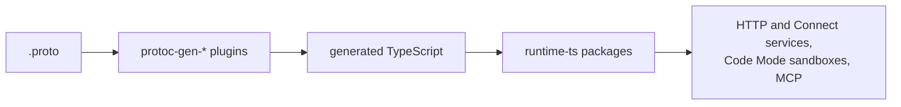

# runtime-ts

[](https://github.com/the-protobuf-project/runtime-ts/actions/workflows/ci.yml)
[](LICENSE)

**The TypeScript runtime underneath code generated from your `.proto` files.**

The protobuf project's plugins turn a proto service into typed clients, servers
and agent tools. What they generate is thin: types, codecs and descriptors. The
work happens here. It is the TypeScript counterpart of
[runtime-go](https://github.com/the-protobuf-project/runtime-go), and every
module is usable by hand as well.

It runs on Node 22.18+, Bun, Deno and Cloudflare Workers, with no build step on
your side: each package ships compiled JavaScript with types.



## Packages

Each folder is its own npm package that builds and ships on its own, like the
modules of runtime-go. Packages depend on each other by name, never by path.

| Package | What it does | Generated against it by |
| --- | --- | --- |
| [`@the-protobuf-project/errors`](errors) | `StatusError` with gRPC codes, and mapping from HTTP and Connect | |
| [`@the-protobuf-project/protobuf`](protobuf) | Binary wire format, protojson, well-known types, enums, resource names, the `Any` registry | every TypeScript plugin |
| [`@the-protobuf-project/network`](network) | `google.api.http` transcoding and Connect clients, a Connect server handler, the `Transport` interface | every TypeScript plugin |
| [`@the-protobuf-project/codemode`](codemode) | Code Mode: executions, approvals, replay, rollback, snippets, search, stores | [protoc-gen-codemode](https://github.com/the-protobuf-project/codemode) |

`@the-protobuf-project/codemode` has an entry point per sandbox and surface, so
their dependencies stay optional; install the ones you use:

| Entry point | What it adds | Needs |
| --- | --- | --- |
| `/quickjs` | Sandbox: QuickJS in WebAssembly (Node, Bun, Deno, browsers) | `quickjs-emscripten` |
| `/deno` | Sandbox: a Deno process with every permission denied | a `deno` binary |
| `/cloudflare` | Sandbox: a Worker Loader isolate; Durable Object storage | Cloudflare Workers |
| `/browser` | Sandbox: a sandboxed iframe | a browser |
| `/mcp` | Serve a runtime as an MCP server | `@modelcontextprotocol/sdk` |
| `/ai` | The Code Mode tool for the Vercel AI SDK | `ai` |

## Install

```sh
npm install @the-protobuf-project/protobuf @the-protobuf-project/network @the-protobuf-project/codemode
npm install quickjs-emscripten            # for codemode/quickjs
```

The packages are not on npm yet. Until they are, build this repository and
depend on the folders: `"@the-protobuf-project/codemode": "file:../runtime-ts/codemode"`.

## Example

```ts
import { createCodemode } from "@the-protobuf-project/codemode";
import { QuickJSExecutor } from "@the-protobuf-project/codemode/quickjs";
import { httpTransport } from "@the-protobuf-project/network";
import { catalog, config, connectors, libraryV1 } from "./gen/index.ts";

const client = new libraryV1.LibraryServiceClient(httpTransport({ baseUrl: "https://library.example.com" }));
const runtime = createCodemode({ catalog, config, connectors: connectors({ library: client }), executor: new QuickJSExecutor() });

await runtime.execute({ code: `async () => (await library.listBooks({ parent: "shelves/poetry" })).books.length` });
```

## Development

An npm workspace: `tsc -b` builds the packages in dependency order through
TypeScript project references, each into its own `dist/`.

```sh
npm install
npm run build          # tsc -b
npm run typecheck      # build, then type-check the tests
npm test               # every package on Node
npm run test:bun
npm run test:deno      # CODEMODE_DENO=<deno binary> runs the Deno sandbox tests from Node and Bun too
npm run lint:lines     # hand-written files stay under 200 lines
```

## License

Licensed under the [Apache License, Version 2.0](LICENSE).

Copyright 2026 The Protobuf Project authors.
