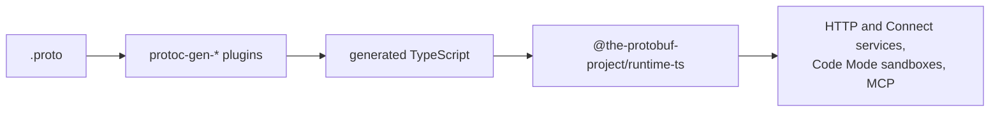

# runtime-ts

[](https://github.com/the-protobuf-project/runtime-ts/actions/workflows/ci.yml)
[](LICENSE)

**The TypeScript runtime underneath code generated from your `.proto` files.**

The protobuf project's plugins turn a proto service into typed clients, servers
and agent tools. What they generate is thin: types, codecs and descriptors. The
work happens here. It is the TypeScript counterpart of
[runtime-go](https://github.com/the-protobuf-project/runtime-go), and every
module is usable by hand as well.

It runs on Bun, Node 22.18+, Deno and Cloudflare Workers, with no build step on
your side: the package ships compiled JavaScript with types.



## Modules

One package, `@the-protobuf-project/runtime-ts`, with a subpath per module. Each
module is its own folder with its own `tsconfig.json`, `src/` and `dist/`,
compiled on its own, in dependency order, by `tsc -b`. Modules import each other
through the package's subpaths, never by relative path, like the modules of
runtime-go.

| Import | What it does | Generated against it by |
| --- | --- | --- |
| [`@the-protobuf-project/runtime-ts/errors`](errors) | `StatusError` with gRPC codes, and mapping from HTTP and Connect | |
| [`@the-protobuf-project/runtime-ts/protobuf`](protobuf) | Binary wire format, protojson, well-known types, enums, resource names, the `Any` registry | every TypeScript plugin |
| [`@the-protobuf-project/runtime-ts/network`](network) | `google.api.http` transcoding and Connect clients, a Connect server handler, the `Transport` interface | every TypeScript plugin |
| [`@the-protobuf-project/runtime-ts/codemode`](codemode) | Code Mode: executions, approvals, replay, rollback, snippets, search, stores | [protoc-gen-codemode](https://github.com/the-protobuf-project/codemode) |

Code Mode has a subpath per sandbox and surface, so their dependencies stay
optional; install the ones you use:

| Import | What it adds | Needs |
| --- | --- | --- |
| `.../codemode/quickjs` | Sandbox: QuickJS in WebAssembly (Bun, Node, Deno, browsers) | `quickjs-emscripten` |
| `.../codemode/deno` | Sandbox: a Deno process with every permission denied | a `deno` binary |
| `.../codemode/cloudflare` | Sandbox: a Worker Loader isolate; Durable Object storage | Cloudflare Workers |
| `.../codemode/browser` | Sandbox: a sandboxed iframe | a browser |
| `.../codemode/mcp` | Serve a runtime as an MCP server | `@modelcontextprotocol/sdk` |
| `.../codemode/ai` | The Code Mode tool for the Vercel AI SDK | `ai` |

## Install

```sh
bun add github:the-protobuf-project/runtime-ts   # until the first npm release
bun add quickjs-emscripten                       # for codemode/quickjs
```

Bun runs the TypeScript sources directly, through the `bun` export condition,
so nothing is built on install. npm, pnpm and yarn build `dist/` on install
(`prepare`) for Node and Deno.

## Example

```ts
import { createCodemode } from "@the-protobuf-project/runtime-ts/codemode";
import { QuickJSExecutor } from "@the-protobuf-project/runtime-ts/codemode/quickjs";
import { httpTransport } from "@the-protobuf-project/runtime-ts/network";
import { catalog, config, connectors, libraryV1 } from "./gen/index.ts";

const client = new libraryV1.LibraryServiceClient(httpTransport({ baseUrl: "https://library.example.com" }));
const runtime = createCodemode({ catalog, config, connectors: connectors({ library: client }), executor: new QuickJSExecutor() });

await runtime.execute({ code: `async () => (await library.listBooks({ parent: "shelves/poetry" })).books.length` });
```

## Development

Bun is the default package manager and test runner; the same tests also run on
Node and Deno in CI.

```sh
bun install
bun run build          # tsc -b: every module, in dependency order
bun run typecheck      # build, then type-check the tests
bun run test           # Bun
bun run test:node
bun run test:deno      # CODEMODE_DENO=<deno binary> runs the Deno sandbox tests under Bun and Node too
bun run lint:lines     # hand-written files stay under 200 lines
```

## License

Licensed under the [Apache License, Version 2.0](LICENSE).

Copyright 2026 The Protobuf Project authors.
