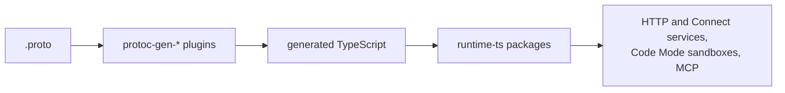

# runtime-ts

[](https://github.com/the-protobuf-project/runtime-ts/actions/workflows/ci.yml)
[](LICENSE)

**The TypeScript runtime underneath code generated from your `.proto` files.**

The protobuf project's plugins turn a proto service into typed clients, servers
and agent tools. What they generate is thin: types, codecs and descriptors. The
work happens here. It is the TypeScript counterpart of
[runtime-go](https://github.com/the-protobuf-project/runtime-go), and every
module is usable by hand as well.

It runs on Bun, Node 22.18+, Deno and Cloudflare Workers, with no build step on
your side: each package ships compiled JavaScript with types.



## Packages

Each folder in [`packages/`](packages) is its own npm package with its own
`package.json`, `tsconfig.json`, `src/` and `dist/`, built and published on its
own, like the modules of runtime-go. Packages depend on each other by name.

| Package                                               | What it does                                                                                           | Generated against it by                                                 |
| ----------------------------------------------------- | ------------------------------------------------------------------------------------------------------ | ----------------------------------------------------------------------- |
| [`@the-protobuf-project/errors`](packages/errors)     | `StatusError` with gRPC codes, and mapping from HTTP and Connect                                       |                                                                         |
| [`@the-protobuf-project/protobuf`](packages/protobuf) | Binary wire format, protojson, well-known types, enums, resource names, the `Any` registry             | every TypeScript plugin                                                 |
| [`@the-protobuf-project/network`](packages/network)   | `google.api.http` transcoding and Connect clients, a Connect server handler, the `Transport` interface | every TypeScript plugin                                                 |
| [`@the-protobuf-project/codemode`](packages/codemode) | Code Mode: executions, approvals, replay, rollback, snippets, search, stores                           | [protoc-gen-codemode](https://github.com/the-protobuf-project/codemode) |

Code Mode has a subpath per sandbox and surface, so their dependencies stay
optional; install the ones you use:

| Import                | What it adds                                                | Needs                       |
| --------------------- | ----------------------------------------------------------- | --------------------------- |
| `codemode/quickjs`    | Sandbox: QuickJS in WebAssembly (Bun, Node, Deno, browsers) | `quickjs-emscripten`        |
| `codemode/deno`       | Sandbox: a Deno process with every permission denied        | a `deno` binary             |
| `codemode/cloudflare` | Sandbox: a Worker Loader isolate; Durable Object storage    | Cloudflare Workers          |
| `codemode/browser`    | Sandbox: a sandboxed iframe                                 | a browser                   |
| `codemode/mcp`        | Serve a runtime as an MCP server                            | `@modelcontextprotocol/sdk` |
| `codemode/ai`         | The Code Mode tool for the Vercel AI SDK                    | `ai`                        |

## Install

The packages are published to [GitHub Packages](https://github.com/orgs/the-protobuf-project/packages).
GitHub's npm registry needs a token to install, even for public packages. Point
the scope at it in an `.npmrc` next to your `package.json`, which Bun, npm, pnpm
and yarn all read:

```ini
@the-protobuf-project:registry=https://npm.pkg.github.com
//npm.pkg.github.com/:_authToken=${GITHUB_TOKEN}
```

Then, with `GITHUB_TOKEN` set to a token that can read packages (`gh auth token`
after `gh auth refresh -s read:packages`, or the workflow's `GITHUB_TOKEN` in
Actions):

```sh
bun add @the-protobuf-project/codemode @the-protobuf-project/network
bun add quickjs-emscripten            # for codemode/quickjs
```

Bun runs the TypeScript sources directly through the `bun` export condition;
Node and Deno use the compiled `dist/`.

## Example

```ts
import { createCodemode } from "@the-protobuf-project/codemode";
import { QuickJSExecutor } from "@the-protobuf-project/codemode/quickjs";
import { httpTransport } from "@the-protobuf-project/network";
import { catalog, config, connectors, libraryV1 } from "./gen/index.ts";

const client = new libraryV1.LibraryServiceClient(httpTransport({ baseUrl: "https://library.example.com" }));
const runtime = createCodemode({
  catalog,
  config,
  connectors: connectors({ library: client }),
  executor: new QuickJSExecutor(),
});

await runtime.execute({ code: `async () => (await library.listBooks({ parent: "shelves/poetry" })).books.length` });
```

## Development

Bun is the default package manager and test runner; the same tests also run on
Node and Deno in CI.

```sh
bun install
bun run build          # tsc -b: every package, in dependency order
bun run typecheck      # build, then type-check the tests
bun run test           # Bun
bun run test:node
bun run test:deno      # CODEMODE_DENO=<deno binary> runs the Deno sandbox tests under Bun and Node too
bun run lint:lines     # hand-written files stay under 200 lines
```

## Releasing

```sh
./scripts/version.sh 0.2.0        # every package, and the ranges between them
git commit -am "chore: release 0.2.0"
git tag v0.2.0 && git push origin main v0.2.0
```

The tag runs [`release.yml`](.github/workflows/release.yml): it checks the
versions match the tag, builds, tests, and publishes every package to GitHub
Packages.

## License

Licensed under the [Apache License, Version 2.0](LICENSE).

Copyright 2026 The Protobuf Project authors.
